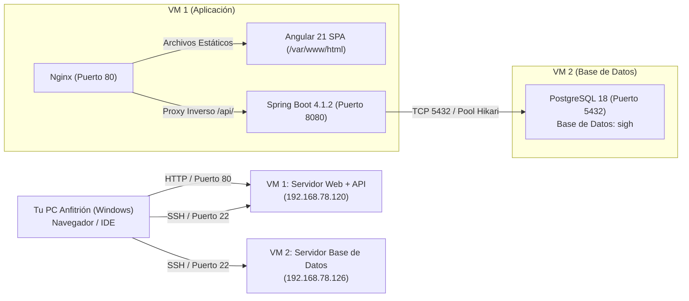

# SIGH — Manual de Creación, Configuración y Despliegue en VirtualBox (Entorno Local)

**Proyecto:** Sistema Integrado de Gestión de Horarios (SIGH)  
**Asignatura:** Bases de Datos 1 — Universidad El Bosque  
**Autor:** David Alejandro Ordaz Luque (Infraestructura y Aplicación)  
**Entorno:** Virtualización Local con Oracle VirtualBox (Ubuntu Server 24.04 / 26.04 LTS)  

---

## 1. Arquitectura del Despliegue Local

Para simular fielmente el entorno de producción que se tuvo en AWS EC2, separamos la solución en **dos máquinas virtuales independientes** comunicadas en la misma red local (LAN) mediante **Adaptador Puente (Bridged Networking)**:



### Tabla de Parámetros de Red y Recursos
| Parámetro | VM 1: Aplicación (Web + API) | VM 2: Base de Datos (RDBMS) |
|---|---|---|
| **Nombre de la VM** | `SIGH-APP-SERVER` | `SIGH-DB-SERVER` |
| **Sistema Operativo** | Ubuntu Server 24.04 / 26.04 LTS (64-bit) | Ubuntu Server 24.04 / 26.04 LTS (64-bit) |
| **Memoria RAM recomendada**| 2048 MB (2 GB) | 1536 MB (1.5 GB) |
| **vCPUs** | 2 Procesadores | 1 Procesador |
| **Disco Virtual (VDI)** | 20 GB (Dinámicamente asignado) | 20 GB (Dinámicamente asignado) |
| **Tipo de Adaptador de Red** | **Adaptador Puente (Bridged)** | **Adaptador Puente (Bridged)** |
| **IP Asignada (Ejemplo)** | `192.168.78.120` | `192.168.78.126` |
| **Usuario / Contraseña** | `user` / `1234` | `user` / `1234` |

---

## 2. Creación e Instalación de las Máquinas en VirtualBox

Repite este procedimiento para crear cada una de las dos máquinas virtuales:

### 2.1. Crear la Máquina Virtual
1. Abre **Oracle VM VirtualBox Manager**.
2. Haz clic en **Nueva (New)**:
   * **Nombre:** `SIGH-DB-SERVER` (o `SIGH-APP-SERVER`).
   * **Tipo:** `Linux`.
   * **Versión:** `Ubuntu (64-bit)`.
   * **Imagen ISO:** Selecciona tu archivo `.iso` de Ubuntu Server (ej. `ubuntu-24.04-live-server-amd64.iso`).
   * Marca la casilla **"Omitir instalación desatendida" (Skip Unattended Installation)** para tener control manual de los pasos.
3. **Hardware:**
   * **Memoria Base:** Asigna entre 1536 MB y 2048 MB.
   * **Procesadores:** 1 o 2 CPUs.
4. **Disco Duro:**
   * Crear un disco duro virtual ahora: 20 GB (VDI con tamaño dinámico).
5. Haz clic en **Terminar**.

---

### 2.2. Configuración Esencial de Red (Adaptador Puente)
> [!IMPORTANT]
> Este paso es el más importante. El modo por defecto de VirtualBox (NAT) aísla la máquina de tu red física y no permite que las dos VMs se comuniquen entre sí ni que tu Windows acceda directamente a su IP sin configurar reenvío de puertos.

1. Selecciona la VM recién creada y haz clic en **Configuración (Settings)** -> **Red (Network)**.
2. En la pestaña **Adaptador 1**:
   * **Conectado a:** Selecciona **Adaptador Puente (Bridged Adapter)**.
   * **Nombre:** Elige la tarjeta de red física que estás usando actualmente en tu computador (por ejemplo: tu tarjeta **Wi-Fi** o tu tarjeta **Ethernet**).
   * En **Avanzadas**, asegúrate de que **Modo Promiscuo** esté en *Denegar* o *Permitir todo*, y que **Cable conectado** esté marcado.
3. Haz clic en **Aceptar**.

---

### 2.3. Instalación de Ubuntu Server en la VM
1. Inicia la máquina virtual.
2. Selecciona tu idioma y distribución de teclado.
3. Tipo de instalación: **Ubuntu Server (minimized)** o estándar.
4. **Configuración de Red:** El instalador solicitará una IP vía DHCP a tu router y mostrará una IP de tu red local (ej. `192.168.78.X`). Anota esta dirección.
5. **Configuración del Almacenamiento:** Deja el particionado automático guiado (usar disco entero).
6. **Perfil de Usuario:**
   * **Your name:** `user`
   * **Your server's name:** `sigh-db` (o `sigh-app`)
   * **Pick a username:** `user`
   * **Choose a password:** `1234`
7. **SSH Setup:** Marca la casilla **[X] Install OpenSSH server** (esto ahorra tener que instalarlo manualmente después).
8. En la pantalla de paquetes adicionales (Snaps), no selecciones ninguno y dale **Done**.
9. Espera a que termine la instalación y selecciona **Reboot Now** (retira la ISO si VirtualBox lo solicita y presiona Enter).

---

## 3. Preparación de las Máquinas Virtuales

Una vez hayan reiniciado, ingresa a la consola de cada máquina con el usuario `user` y la clave `1234`.

### 3.1. Máquina 1: Base de Datos (`192.168.78.126`)

Ejecuta en su terminal:
```bash
# 1. Actualizar repositorios e instalar paquetes de PostgreSQL y OpenSSH
sudo apt update
sudo apt install -y openssh-server postgresql postgresql-contrib

# 2. Habilitar servicio SSH en caso de que esté inactivo
sudo systemctl enable --now ssh

# 3. Permitir tráfico en el firewall para SSH y PostgreSQL
sudo ufw allow 22/tcp
sudo ufw allow 5432/tcp

# 4. Confirmar la IP asignada
hostname -I
```

---

### 3.2. Máquina 2: Aplicación Web y API (`192.168.78.120`)

Ejecuta en su terminal:
```bash
# 1. Actualizar repositorios e instalar Java 17, Nginx y utilitarios
sudo apt update
sudo apt install -y openssh-server openjdk-17-jdk nginx curl

# 2. Habilitar servicio SSH
sudo systemctl enable --now ssh

# 3. Abrir puertos en el firewall para SSH y Web (HTTP)
sudo ufw allow 22/tcp
sudo ufw allow 80/tcp

# 4. Confirmar la IP asignada
hostname -I
```

---

## 4. Compilación de los Proyectos en Windows (Host)

En tu máquina anfitriona (Windows), donde tienes el código fuente del proyecto:

### 4.1. Compilar el Frontend (Angular 21)
Abre PowerShell en la carpeta del frontend y compila los artefactos de producción:
```powershell
cd C:\Users\dorda\IdeaProjects\proyecto_db\source\front-end\front-horarios
npm install
npm run build
```
*Esto genera la carpeta compilada lista para producción en:*  
`source/front-end/front-horarios/dist/front-horarios/browser/`

### 4.2. Compilar el Backend (Spring Boot 4.1.2)
Abre PowerShell en la carpeta del backend y genera el archivo `.jar`:
```powershell
cd C:\Users\dorda\IdeaProjects\proyecto_db\source\back-end\api_horarios
.\gradlew.bat bootJar --no-daemon
```
*Esto genera el artefacto ejecutable en:*  
`source/back-end/api_horarios/build/libs/apihorarios-0.0.1-SNAPSHOT.jar`

---

## 5. Despliegue y Puesta en Marcha

Para subir todo y dejar los servicios corriendo, dispones de dos alternativas: **el script automatizado** (recomendado para ahorrar tiempo) o el **método manual paso a paso**.

---

### Opción A: Despliegue Automatizado (Recomendada)

Desde la raíz del proyecto en Windows (`C:\Users\dorda\IdeaProjects\proyecto_db`), ejecuta el script PowerShell con bypass de directivas:

```powershell
powershell -ExecutionPolicy Bypass -File .\deploy_vbox.ps1 -SkipBuild
```

*(O si prefieres usar Python):*
```bash
python deploy_vbox.py --skip-build
```

**¿Qué hace este script tras bambalinas?**
1. Conecta vía SSH a la VM BD (`192.168.78.126`), asegura el cluster de PostgreSQL y configura `listen_addresses = '*'` y `pg_hba.conf`.
2. Sube los scripts SQL de `source/db/` (`01_ddl.sql` al `07_pruebas_reglas.sql`) y los ejecuta en orden pasando la contraseña de los roles de conexión.
3. Conecta a la VM APP (`192.168.78.120`), sube los archivos estáticos de Angular a `/var/www/html` y configura Nginx con soporte SPA y proxy inverso hacia `/api/`.
4. Sube el `.jar` de Spring Boot a `/home/user/app/api/`, crea el servicio `sigh-api.service` en `systemd` inyectando las variables de base de datos (`DB_HOST=192.168.78.126`, `DB_PORT=5432`, `DB_NAME=sigh`), y arranca el servicio.
5. Ejecuta una prueba automática de salud contra `http://192.168.78.120/api/echo`.

---

### Opción B: Despliegue Manual Paso a Paso (Para el Sustento Técnico)

Si deseas realizar o explicar la configuración de manera manual:

#### 1. Configuración de PostgreSQL en la VM BD (`192.168.78.126`)
1. Editar `/etc/postgresql/18/main/postgresql.conf`:
   ```ini
   listen_addresses = '*'
   ```
2. Autorizar a la VM APP en `/etc/postgresql/18/main/pg_hba.conf`:
   ```text
   # Conexión exclusiva para la red local de la VM Aplicación
   host    all    all    192.168.78.0/24    scram-sha-256
   host    all    all    192.168.78.0/24    md5
   ```
3. Reiniciar el motor de base de datos:
   ```bash
   sudo systemctl restart postgresql
   ```
4. Subir la carpeta de scripts desde Windows:
   ```powershell
   scp -r C:\Users\dorda\IdeaProjects\proyecto_db\source\db\* user@192.168.78.126:/tmp/sigh_db/
   ```
5. En la VM BD, ejecutar los scripts en orden:
   ```bash
   cd /tmp/sigh_db
   sudo -u postgres psql -f 01_ddl.sql
   sudo -u postgres psql -d sigh -f 02_catalogos.sql
   sudo -u postgres psql -d sigh -f 03_funciones_triggers.sql
   sudo -u postgres psql -d sigh -f 04_vistas.sql
   sudo -u postgres psql -d sigh -v app_password='1234' -f 05_roles_permisos.sql
   sudo -u postgres psql -d sigh -f 06_datos_prueba.sql
   sudo -u postgres psql -d sigh -f 07_pruebas_reglas.sql
   ```
   *(El script 07 debe arrojar el resumen `46 | 46 | 0`, confirmando que todas las reglas fueron validadas exitosamente).*

#### 2. Configuración del Servidor Web Nginx en la VM APP (`192.168.78.120`)
1. Subir los archivos compilados de Angular desde Windows:
   ```powershell
   scp -r C:\Users\dorda\IdeaProjects\proyecto_db\source\front-end\front-horarios\dist\front-horarios\browser\* user@192.168.78.120:/tmp/sigh_dist/
   ```
2. En la VM APP, publicar los archivos en Nginx:
   ```bash
   sudo rm -rf /var/www/html/*
   sudo cp -r /tmp/sigh_dist/* /var/www/html/
   sudo chown -R www-data:www-data /var/www/html
   sudo chmod -R 755 /var/www/html
   ```
3. Configurar el archivo `/etc/nginx/sites-available/default`:
   ```nginx
   server {
       listen 80 default_server;
       listen [::]:80 default_server;

       root /var/www/html;
       index index.html;
       server_name _;

       # Soporte para rutas SPA en Angular (evita error 404 al recargar)
       location / {
           try_files $uri $uri/ /index.html;
       }

       # Proxy inverso hacia el backend Spring Boot
       location /api/ {
           proxy_pass http://localhost:8080/api/;
           proxy_http_version 1.1;
           proxy_set_header Host $host;
           proxy_set_header X-Real-IP $remote_addr;
           proxy_set_header X-Forwarded-For $proxy_add_x_forwarded_for;
           proxy_set_header X-Forwarded-Proto $scheme;
       }
   }
   ```
4. Probar y recargar Nginx:
   ```bash
   sudo nginx -t && sudo systemctl reload nginx
   ```

#### 3. Configuración del Backend Spring Boot como Servicio Systemd
1. Crear el directorio de despliegue en la VM APP:
   ```bash
   mkdir -p /home/user/app/api
   ```
2. Subir el archivo `.jar` desde Windows:
   ```powershell
   scp C:\Users\dorda\IdeaProjects\proyecto_db\source\back-end\api_horarios\build\libs\apihorarios-0.0.1-SNAPSHOT.jar user@192.168.78.120:/home/user/app/api/
   ```
3. Crear el archivo del servicio `/etc/systemd/system/sigh-api.service`:
   ```ini
   [Unit]
   Description=Servicio API SIGH Spring Boot
   After=network.target

   [Service]
   User=user
   WorkingDirectory=/home/user/app/api
   Environment="DB_HOST=192.168.78.126"
   Environment="DB_PORT=5432"
   Environment="DB_NAME=sigh"
   Environment="DB_USER=app_administrador"
   Environment="DB_PASSWORD=1234"
   ExecStart=/usr/bin/java -Xmx400m -jar /home/user/app/api/apihorarios-0.0.1-SNAPSHOT.jar
   SuccessExitStatus=143
   Restart=always
   RestartSec=10

   [Install]
   WantedBy=multi-user.target
   ```
4. Habilitar e iniciar el servicio:
   ```bash
   sudo systemctl daemon-reload
   sudo systemctl enable sigh-api
   sudo systemctl start sigh-api
   ```

---

## 6. Verificación y Pruebas del Sistema

Una vez desplegado, abre el navegador en tu máquina física (Windows) y comprueba los siguientes accesos:

| Componente | URL de Prueba | Resultado Esperado |
|---|---|---|
| **Frontend Web** | `http://192.168.78.120/` | Carga inmediata de la página inicial de SIGH sin errores visuales. |
| **Login Directo** | `http://192.168.78.120/#/login` | Formulario de autenticación interactivo. |
| **Estado de Conexión** | `http://192.168.78.120/#/conexion` | Indicador en verde confirmando conexión entre Angular y Spring Boot. |
| **API Echo (Nginx)** | `http://192.168.78.120/api/echo` | Respuesta JSON con estado `UP` y timestamp del servidor. |
| **Login API (JWT)** | `POST http://192.168.78.120/api/auth/login` | Autenticación con `admin` / `123456` retorna Token Bearer y rol `ADMINISTRADOR`. |

---

## 7. Solución de Problemas Comunes (Troubleshooting)

### Error 1: "ExecutionPolicy" al ejecutar el script en Windows
* **Causa:** PowerShell restringe scripts `.ps1` no firmados por defecto.
* **Solución:** Ejecutar siempre anteponiendo el bypass:
  ```powershell
  powershell -ExecutionPolicy Bypass -File .\deploy_vbox.ps1
  ```

### Error 2: "Connection refused" al conectar por SSH a una VM
* **Causa:** El paquete `openssh-server` no está instalado o el servicio no está corriendo en la VM.
* **Solución:** Entrar por la consola de VirtualBox y ejecutar:
  ```bash
  sudo apt update && sudo apt install -y openssh-server && sudo systemctl enable --now ssh
  ```

### Error 3: "sudo: /etc/sudoers is owned by uid ..., should be 0"
* **Causa:** Permisos alterados accidentalmente en el archivo `/etc/sudoers`.
* **Solución:** Reiniciar la VM en **Recovery Mode**, entrar a la consola root y ejecutar:
  ```bash
  mount -o remount,rw /
  chown root:root /etc/sudoers && chmod 440 /etc/sudoers
  reboot
  ```

### Error 4: "connection to server on socket ... failed: No such file or directory"
* **Causa:** El cluster de PostgreSQL está apagado (`down`).
* **Solución:** En la VM de base de datos, recrear el cluster limpio:
  ```bash
  sudo pg_dropcluster 18 main --stop
  sudo pg_createcluster -u postgres -g postgres -e UTF-8 18 main --start
  ```
