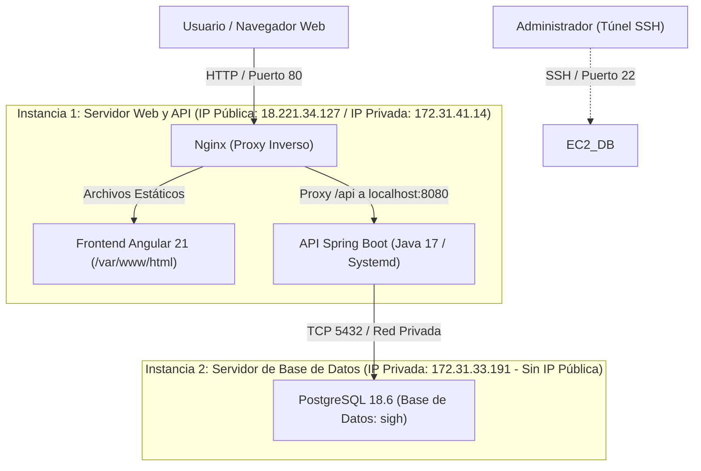

# SIGH — Implementación y Despliegue en AWS (VM y RDBMS)

**Proyecto:** Sistema Integrado de Gestión de Horarios (SIGH)  
**Asignatura:** Bases de Datos 1 — Universidad El Bosque  
**Responsable de Infraestructura:** David Alejandro Ordaz Luque  
**Versión:** 2.0 (Actualizada — Corrige hallazgos A1, A2, A3, A4, A5, C1 y C2)  

---

## 1. Arquitectura de Despliegue en AWS EC2

Para garantizar alta seguridad, aislamiento de fallos y desempeño óptimo dentro de la capa gratuita de AWS (Free Tier), el sistema se despliega en **dos instancias EC2 independientes** comunicadas a través de la red privada virtual (VPC):



### Características de las Instancias
| Parámetro | Instancia 1 (Frontend + Backend) | Instancia 2 (Base de Datos) |
|---|---|---|
| **Propósito** | Servidor Web Nginx, Angular SPA y API Spring Boot | Servidor RDBMS PostgreSQL |
| **Tipo de Instancia** | `t3.micro` (1 vCPU, 1 GB RAM, Capa Gratuita) | `t3.micro` (1 vCPU, 1 GB RAM, Capa Gratuita) |
| **Sistema Operativo** | Ubuntu Server 24.04 / 26.04 LTS (64-bit x86) | Ubuntu Server 24.04 / 26.04 LTS (64-bit x86) |
| **IP Privada VPC** | `172.31.41.14` | `172.31.33.191` |
| **Acceso Público** | Sí (IP pública elástica / dinámica con puerto 80) | **NO** (Aislada; acceso solo por red privada o túnel SSH) |

---

## 2. Grupos de Seguridad (AWS Security Groups)

### Instancia 1: `sg-sigh-web-api`
| Tipo | Protocolo | Puerto | Origen | Propósito |
|---|---|---|---|---|
| SSH | TCP | 22 | IP del Administrador | Gestión remota segura por consola |
| HTTP | TCP | 80 | `0.0.0.0/0` (Público) | Acceso de usuarios al frontend y proxy de API |
| HTTPS | TCP | 443 | `0.0.0.0/0` (Público) | Tráfico seguro TLS (preparado para dominio) |

> [!NOTE]
> **Resolución de Hallazgo A3:** El puerto `8080` que se encontraba abierto temporalmente ha sido **cerrado al exterior**. Todas las peticiones cliente hacia la API viajan por el puerto 80 hacia la ruta `/api`, la cual es redirigida internamente por Nginx a `localhost:8080`.

### Instancia 2: `sg-sigh-database`
| Tipo | Protocolo | Puerto | Origen | Propósito |
|---|---|---|---|---|
| SSH | TCP | 22 | IP del Administrador | Conexión administrativa y creación de túneles SSH |
| PostgreSQL | TCP | 5432 | `172.31.41.14/32` (IP Privada Instancia 1) | Acceso exclusivo para la API Spring Boot |

*La base de datos no tiene expuesto el puerto 5432 a Internet, mitigando riesgos de intrusión o fuerza bruta.*

---

## 3. Configuración e Instalación del RDBMS (Instancia 2)

### 3.1. Instalación de PostgreSQL
Se instala el motor oficial y los módulos de contribución:
```bash
sudo apt update && sudo apt install postgresql postgresql-contrib -y
```

Para verificar la versión exacta instalada (Resolución Hallazgo A2):
```sql
sudo -u postgres psql -c "SELECT version();"
-- Retorna: PostgreSQL 18.6 (o PostgreSQL 16.x) en x86_64-pc-linux-gnu
```

### 3.2. Configuración de Escucha y Conectividad Remota
1. En `/etc/postgresql/<version>/main/postgresql.conf`:
   ```ini
   listen_addresses = '*'
   ```
2. En `/etc/postgresql/<version>/main/pg_hba.conf`, autorizar únicamente a la Instancia 1:
   ```text
   # Conexión exclusiva para la IP Privada del Servidor de Aplicaciones
   host    sigh    all    172.31.41.14/32    scram-sha-256
   ```
3. Reiniciar el servicio:
   ```bash
   sudo systemctl restart postgresql
   ```

### 3.3. Creación de la Base de Datos y Roles (Resolución A1, C1 y C2)
El nombre oficial de la base de datos es **`sigh`** (no *horariosdb*).

Para ejecutar los scripts sin exponer contraseñas en consola:
```bash
# 1. Crear base y estructura
sudo -u postgres psql -f source/db/01_ddl.sql

# 2. Cargar catálogos
sudo -u postgres -d sigh -f source/db/02_catalogos.sql

# 3. Funciones y disparadores
sudo -u postgres -d sigh -f source/db/03_funciones_triggers.sql

# 4. Vistas
sudo -u postgres -d sigh -f source/db/04_vistas.sql

# 5. Roles y permisos (se suministra contraseña segura al vuelo)
sudo -u postgres -d sigh -v app_password='<CONTRASEÑA_SEGURA>' -f source/db/05_roles_permisos.sql

# 6. Datos de prueba y 7. Verificación de reglas
sudo -u postgres -d sigh -f source/db/06_datos_prueba.sql
sudo -u postgres -d sigh -f source/db/07_pruebas_reglas.sql
```

> [!IMPORTANT]
> **Cambio de Contraseña de Postgres (Resolución C1):**
> Para garantizar que nadie use credenciales anteriores:
> ```bash
> sudo -u postgres psql -c "\password postgres"
> ```

---

## 4. Configuración del Servidor Web y API (Instancia 1)

### 4.1. Instalación de Dependencias
```bash
sudo apt update && sudo apt install openjdk-17-jdk nginx -y
```

### 4.2. Configuración de Nginx como Servidor Web y Proxy Inverso
Editar `/etc/nginx/sites-available/default`:
```nginx
server {
    listen 80 default_server;
    listen [::]:80 default_server;

    root /var/www/html;
    index index.html;

    server_name _;

    # Servir Frontend Angular con soporte para rutas internas
    location / {
        try_files $uri $uri/ /index.html;
    }

    # Proxy inverso seguro hacia Spring Boot
    location /api/ {
        proxy_pass http://localhost:8080/api/;
        proxy_http_version 1.1;
        proxy_set_header Host $host;
        proxy_set_header X-Real-IP $remote_addr;
        proxy_set_header X-Forwarded-For $proxy_add_x_forwarded_for;
        proxy_set_header X-Forwarded-Proto $scheme;
    }
}
```
Verificar y recargar:
```bash
sudo nginx -t && sudo systemctl restart nginx
```

### 4.3. Servicio Systemd para la API Spring Boot (Resolución C1 y C2)
Se crea `/etc/systemd/system/sigh-api.service` inyectando variables de entorno seguras para el usuario aplicativo `app_administrador` (nunca *postgres*):
```ini
[Unit]
Description=Servicio API SIGH Spring Boot
After=network.target

[Service]
User=ubuntu
WorkingDirectory=/home/ubuntu/app/api
Environment="DB_HOST=172.31.33.191"
Environment="DB_PORT=5432"
Environment="DB_NAME=sigh"
Environment="DB_USER=app_administrador"
Environment="DB_PASSWORD=<CONTRASEÑA_DEFINIDA_EN_SCRIPT_05>"
ExecStart=/usr/bin/java -jar /home/ubuntu/app/api/api_horarios-0.0.1-SNAPSHOT.jar
SuccessExitStatus=143
Restart=always
RestartSec=10

[Install]
WantedBy=multi-user.target
```

Habilitar el servicio:
```bash
sudo systemctl daemon-reload
sudo systemctl enable sigh-api
sudo systemctl start sigh-api
```

---

## 5. Administración Remota por Túnel SSH (Hallazgo A4)

Dado que la base de datos no tiene IP pública, la administración mediante herramientas visuales locales (DBeaver, pgAdmin, Data Modeler) se realiza mediante un túnel SSH seguro:

```powershell
ssh -i "connection_keys.pem" -L 5432:localhost:5432 ubuntu@<IP_PUBLICA_INSTANCIA_BD>
```
Con el túnel activo, la herramienta local se conecta a:
* **Host:** `localhost`
* **Puerto:** `5432`
* **Base de datos:** `sigh`
* **Usuario:** `app_administrador` o `sigh_owner`

---

## 6. Lista de Evidencias y Capturas para el Informe Final (Hallazgo A4)

Para complementar este documento técnico y el PDF de entrega, David debe incluir las siguientes capturas de pantalla organizadas:

1. **Consola AWS EC2:**
   * Vista de las dos instancias en estado `Running` (`t3.micro`, Ubuntu Server).
   * Vista de los Grupos de Seguridad (`sg-sigh-web-api` con puertos 22/80 y `sg-sigh-database` con puerto 5432 restringido).
2. **Terminal SSH - Instancia 2 (Base de Datos):**
   * Salida del comando `SELECT version();` confirmando versión de PostgreSQL.
   * Ejecución exitosa de los scripts `01` a `07` (mostrando el resumen `41 | 41 | 0` de `07_pruebas_reglas.sql`).
3. **Terminal SSH - Instancia 1 (Web / API):**
   * Salida de `systemctl status sigh-api` (mostrando el servicio activo y en ejecución).
   * Salida de `systemctl status nginx` (mostrando Nginx activo).
4. **Navegador Web:**
   * Frontend Angular cargando en `http://<IP_PUBLICA_INSTANCIA_1>/` consumiendo datos de `/api/catalogo/docentes`.
   * Pestaña Network del navegador confirmando peticiones a `/api` con código HTTP 200 sin referencias a puerto 8080.
5. **DBeaver / Data Modeler:**
   * Conexión exitosa a través del túnel SSH mostrando el esquema físico de las 20 tablas y las 7 vistas.
